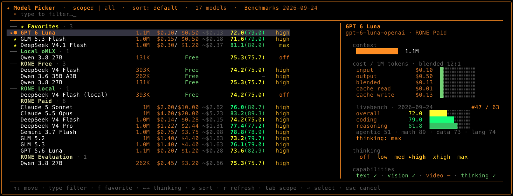

# Pi Model Picker

Choose the right model without guessing at cost, context limits, model quality, or thinking support. Pi Model Picker is a keyboard-driven model switcher TUI for [Pi](https://pi.dev).



## Install

```bash
pi install npm:@kylelavorato/pi-model-picker
```

Restart Pi or run `/reload`, then press **Ctrl+Shift+L** or type **`/models`**.

## Pick with confidence

- **Compare models at a glance.** See context window, input and output price per million tokens, blended cost, and supported thinking levels. The detail panel adds cost and context bars plus text, vision, video, and reasoning capabilities.
- **Check benchmark results.** View LiveBench overall, agentic, and coding scores, category breakdowns, and leaderboard rank alongside each model. Data is cached locally, refreshed in the background at most once a day, and dated in the picker. Press `r` to refresh it manually.
- **Find and organize your options.** Models are grouped by provider, with favorites pinned to the top. Type to fuzzy-filter, cycle sorting by default order, price, context, score, or name, and switch between session-scoped models and the full catalog.
- **Pick your favourites.** Press `f` on any model to set it as a favourite so it always appears at the top of the list and is easy to access.
- **Set thinking per model.** Preview and change a model's supported thinking level before switching. The picker remembers the last level used for each model.
- **Keep the overview in view.** A two-pane comparison appears in wide terminals; narrower terminals switch to a compact layout.

## Keyboard controls

| Key | Action |
|---|---|
| Type | Fuzzy-filter models |
| `↑` / `↓` | Move through the list |
| `Enter` | Switch to the selected model |
| `←` / `→` | Change its thinking level |
| `f` | Add or remove a favorite |
| `s` | Cycle sort order |
| `Tab` | Toggle scoped/all models |
| `r` | Refresh LiveBench data |
| `Esc` | Clear the filter or close the picker |

The shortcut requires a terminal that reports shifted control chords distinctly.

## Benchmark scores

Scores come from the [LiveBench v2](https://livebench.ai) leaderboard (the number in brackets is the average of the coding and agentic scores). Each score is colour-coded by band:

| Range | Colour | Meaning |
|---|---|---|
| 80+ | Dark green | Elite |
| 70–79.9 | Light green | Strong |
| 60–69.9 | Yellow | Mid |
| 50–59.9 | Red | Weak |
| Below 50 | Dark red | Poor |
